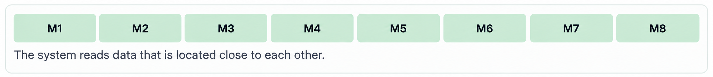
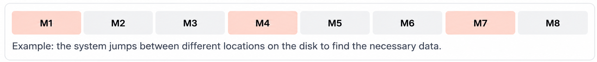

## **Concepts: Cheat sheet**

### **1. Random seeks**

- A random seek occurs when the system needs to access a specific location on disk that is not necessarily adjacent to the location accessed previously

Sequential Read: 

Random Seeks Read - potentially more expensive: 

- **HDD:** The disk has to physically move its read head to find data in different locations, which takes extra time
- **SSD:** The disk has no moving parts, so accessing data is faster. However, reading data from many different locations can still take extra time

### **2. Disk cache evictions**

- Occurs when data is removed from the cache to free up space for other data

- The cache stores data that may be accessed again, allowing the system to retrieve it more quickly without having to read it from storage again

- When new data needs to be loaded into a full cache, some existing data must be evicted to make room

***Why is this a problem?***

- If frequently accessed data is evicted, future requests may need to retrieve it from disk again, increasing I/O operations and potentially reducing performance.

- In Discord's case, retrieving just 50 messages can involve many random seeks, which may cause disk cache evictions and affect the efficiency of subsequent data accesses.

